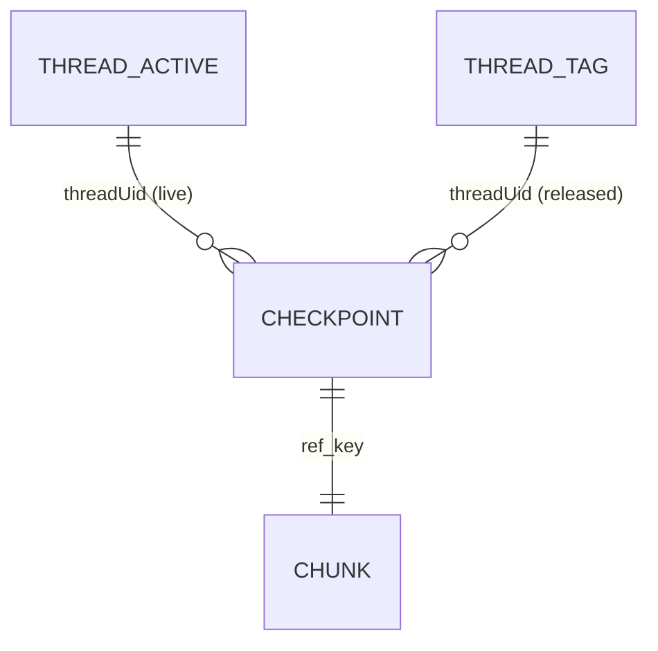

# DynamoDB Checkpoint Saver V2

Version 2 is implemented by `org.bsc.langgraph4j.checkpoint.DynamoDBSaverV2`. Like the other V2
savers (PostgreSQL, SQLite, MySQL, Oracle) and `MongoDBSaver`, it **archives on release**: every
release of a thread becomes a versioned *tag* that records error status and a message, and can be
read back with `tag(config, version)`. Live threads also record interruption state.
`DynamoDBSaverV2Dashboard` lists live threads and tags for dashboards and admin tools.

Use V2 for new applications. V2 uses its own table layout and is **not compatible** with tables
written by the V1 [`DynamoDBSaver`](./README.md); use a new table.

## Data Architecture

All items share one table, with the string keys `PK` (partition) and `SK` (sort):

| Item | `PK` | `SK` | Main attributes |
| --- | --- | --- | --- |
| Live execution | `THREAD_<threadName>` | `ACTIVE` | `threadUid`, `seq`, `isInterrupted`, `message`, `createdAt`, `GSI1PK=THREAD`, `GSI1SK` |
| Release tag | `THREAD_<threadName>` | `V#<version, 10 digits>` | `threadUid`, `version`, `isError`, `message`, `createdAt`, `releasedAt`, `GSI1PK=TAG`, `GSI1SK` |
| Checkpoint metadata | `CHECKPOINT_<threadUid>` | `<checkpointId>` | `nodeId`, `nextNodeId`, `contentType`, `seq`, `savedAt`, `ref_loc`, `ref_key` |
| Serialized state | `CHUNK_<threadUid>#<checkpointId>` | `CHUNK` | `payload` |

Payloads larger than 350 KiB go to S3 when configured, under
`<prefix>/<threadUid>/checkpoints/<checkpointId>`.



Each execution of a thread gets a new random `threadUid` when its `ACTIVE` item is created, on its
first checkpoint. Checkpoints never move: releasing only replaces the `ACTIVE` item with a tag that
keeps the same `threadUid`. The history of a thread is ordered by `seq`, a counter reserved
atomically on the `ACTIVE` item, so ordering does not depend on timestamps.

### Dashboard index (`GSI1`)

`GSI1` is a global secondary index on `GSI1PK` (partition) and `GSI1SK` (sort). It is *sparse*:
only `ACTIVE` items and tags carry `GSI1PK`, so listing threads or tags reads only those items,
never checkpoints or payloads.

| `GSI1PK` | `GSI1SK` | Items |
| --- | --- | --- |
| `THREAD` | `<createdAt, 13 digits>#<threadName>` | live executions, newest first |
| `TAG` | `<releasedAt, 13 digits>#<threadName>#<version>` | release tags, newest first |

`createTableIfNotExists(true)` creates the index. **If you provision the table yourself, add
`GSI1`** (both keys of type `S`, projection `ALL`) to use `DynamoDBSaverV2Dashboard`; the saver
itself never reads the index.

## Design

When a checkpoint is saved, the saver:

1. Updates the `ACTIVE` item in one `UpdateItem`: creates it with a new `threadUid` if absent,
   increments `seq`, clears the interruption flag and refreshes `ttl`.
2. Writes the payload (DynamoDB chunk or S3) and the checkpoint metadata under
   `CHECKPOINT_<threadUid>` with the reserved `seq`.

Updating a checkpoint replaces it in place: the new checkpoint keeps the `seq` of the old one.

When the thread is released, the saver:

1. Computes the next version: the last `V#` tag of the thread plus one.
2. In one `TransactWriteItems`, deletes the `ACTIVE` item (only if it still holds the loaded
   `threadUid`) and writes the `V#<version>` tag (only if that version does not exist yet).
3. If a concurrent release took the version, it retries with the next one; if the `ACTIVE` item
   was already released, it returns a tag without version.

`releaseOnError(...)` sets `isError` and stores the error message (the `GraphRunnerException`
message when present). `registerInterruption(...)` sets `isInterrupted` and stores the reason on
the `ACTIVE` item; the next saved checkpoint clears it.

## Release Tags

```java
var config = RunnableConfig.builder()
        .threadId("customer-support-thread")
        .build();

var first  = saver.tag(config, 1);     // a specific release
var latest = saver.lastTag(config);    // the latest release
```

## Dashboard

`DynamoDBSaverV2Dashboard` is a read-only companion. It never creates or drops the table, and every
write operation throws `UnsupportedOperationException`.

```java
var dashboard = DynamoDBSaverV2Dashboard.builder()
        .tableName("langgraph4j-checkpoints-v2")
        .dynamoDbClient(client)
        .stateSerializer(new ObjectStreamStateSerializer<>(AgentState::new))
        .build();

List<DynamoDBSaverV2Dashboard.ThreadRecord> threads = dashboard.selectAllThreads();
List<DynamoDBSaverV2Dashboard.TagRecord> tags = dashboard.selectAllTags();

// checkpoints of a live thread, or of a release
var live = dashboard.list(RunnableConfig.builder().threadId("thread-1").build());
var released = dashboard.tag(RunnableConfig.builder().threadId("thread-1").build(), 1);
```

## Build a Saver

```java
try (var client = DynamoDbClient.builder()
        .region(Region.US_EAST_1)
        .build()) {

    var saver = DynamoDBSaverV2.builder()
            .tableName("langgraph4j-checkpoints-v2")
            .dynamoDbClient(client)
            .stateSerializer(new ObjectStreamStateSerializer<>(AgentState::new))
            .createTableIfNotExists(true)
            .build();

    var workflow = graph.compile(CompileConfig.builder()
            .checkpointSaver(saver)
            .build());
}
```

The builder options are the same as V1 (`tableName`, `dynamoDbClient`, `stateSerializer`,
`ttlSeconds`, `createTableIfNotExists`, `dropTableFirst`, `s3Bucket`, `s3Client`, `s3KeyPrefix`).

## TTL and Cleanup

With `ttlSeconds(...)`, every item carries a `ttl` attribute (epoch seconds); enable DynamoDB TTL on
the table's `ttl` attribute separately. The `ACTIVE` item refreshes its `ttl` on every checkpoint.
Tags are written when the execution is released, so a tag can outlive the checkpoints of its
execution: `tag(...)` then returns fewer (or no) checkpoints.

`saver.deleteThread("thread-1")` permanently deletes the `ACTIVE` item, every tag, and the
checkpoints and payloads of every execution of the thread.

## Limitations

- V2 is not compatible with V1 tables; there is no migration from V1.
- The `GSI1` partitions `THREAD` and `TAG` hold every live thread and every tag. This keeps listing
  cheap, but very high release rates concentrate index writes on those two partitions.
- Index reads are eventually consistent: a thread or tag can appear in the dashboard a moment after
  it is written. The saver itself uses strongly consistent reads.
- Payload and metadata writes are separate operations. Replacing an S3-backed checkpoint does not
  delete its previous S3 object; use bucket lifecycle rules for residual objects.
